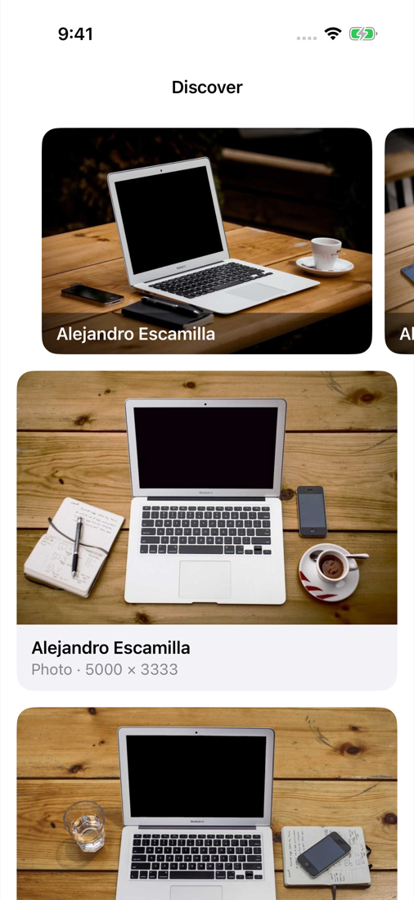
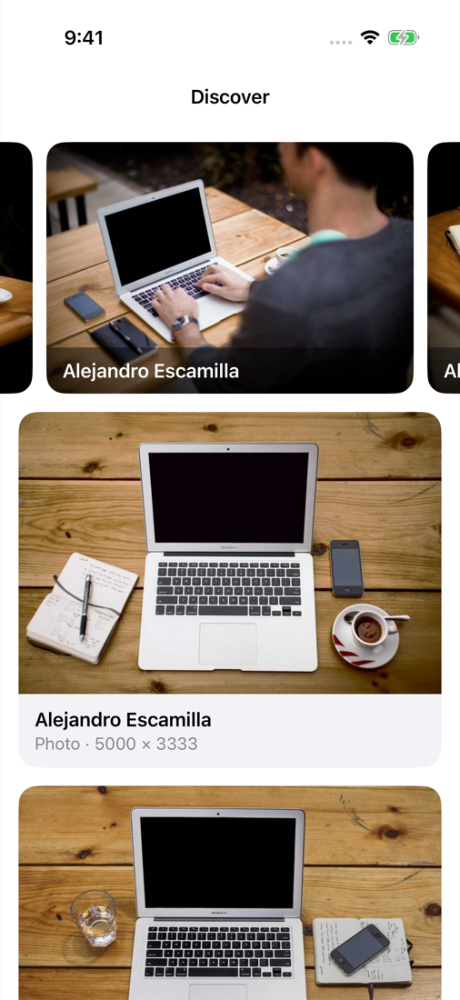
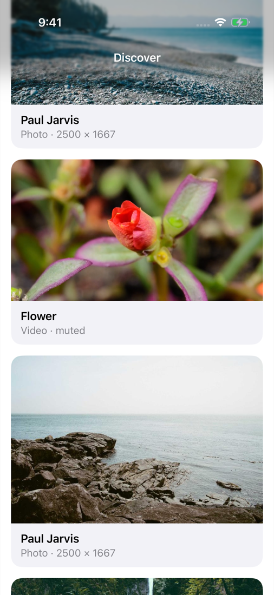
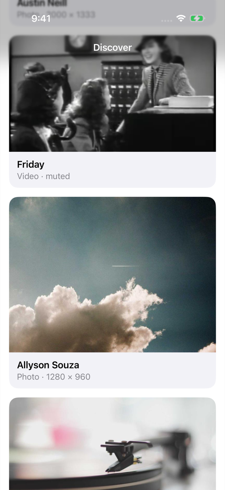
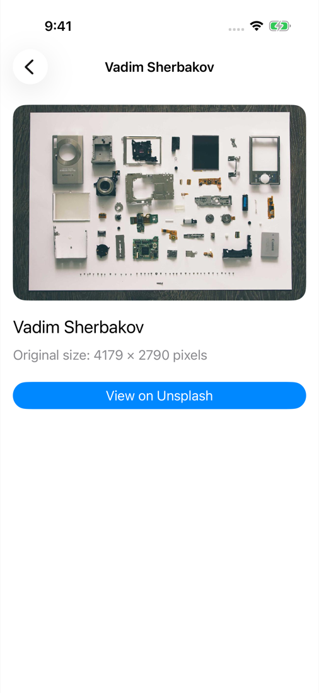
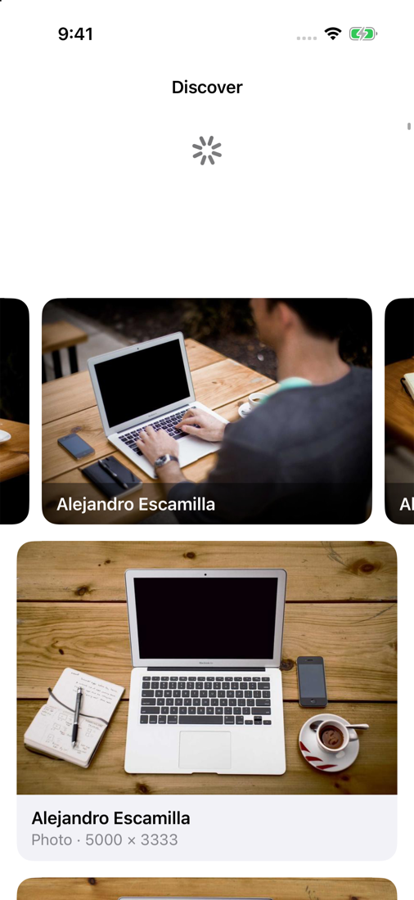

# FeedKit Demo

A small iPhone app that shows a scrolling feed of photos and short videos. It is written in UIKit with code only: no storyboards, no SwiftUI, and no third-party libraries. It is meant to be read and learned from, so the code favours being clear over being clever.

The photos come from [Picsum](https://picsum.photos), which is free and needs no API key. The videos are short public sample clips from MDN and test-videos.co.uk.

## What the app does

- A horizontal carousel of featured photos at the top. You swipe it sideways and it snaps to each card.
- A vertical list of photo cards below, with a muted video card after every sixth photo.
- More photos load by themselves as you get near the bottom. If loading fails, a Retry button appears at the bottom.
- Pull down at the top to refresh the feed.
- Images are cached in memory and shrunk to the size they are shown at, so scrolling stays smooth.
- The video card that is mostly on screen plays by itself, muted. All the others are paused, so only one plays at a time.
- Tap a photo to open a detail screen. Tap a video to watch it full screen with sound.

## Screenshots

These were taken from the app running in the iOS Simulator (iPhone 17 Pro, iOS 26.5).

| Feed | Carousel swiped | Video card playing | Page 2 loaded |
| --- | --- | --- | --- |
|  |  |  |  |

| Detail screen | Pull to refresh | First load |
| --- | --- | --- |
|  |  |  |

"Page 2 loaded" shows the "Friday" clip. That is the fifth video, and it only appears after the second page of photos has arrived.

## How to run it

You need a Mac with Xcode. It was built and tested with Xcode 27.1; the project file format needs Xcode 16 or newer. The app runs on iOS 17 or later.

1. Clone the repo and open `FeedKitDemo.xcodeproj` in Xcode.
2. Pick an iPhone simulator at the top of the window.
3. Press Cmd+R to run, or Cmd+U to run the unit tests.

From the terminal:

```sh
# Build and run the tests on a simulator
xcodebuild test \
  -project FeedKitDemo.xcodeproj \
  -scheme FeedKitDemo \
  -destination 'platform=iOS Simulator,name=iPhone 17 Pro'
```

The app needs an internet connection to load photos and videos.

## How the code is organised

The app follows MVVM (Model, View, ViewModel). View controllers only draw the screen and pass on what the user does. The view model holds the feed's state and asks the network for data. The models are plain data.

```
FeedKitDemo/
  App/          AppDelegate, SceneDelegate: start the app and create the window
  Models/       Photo, Video, FeedItem: plain data
  Networking/   APIClient: fetches photo pages with async/await and Codable
  Images/       ImageCache, ImageDownsampler, ImageLoader, RemoteImageView
  Feed/         FeedViewModel, FeedViewController, FeedLayout, and the cells
  Detail/       PhotoDetailViewController
FeedKitDemoTests/  Unit tests for the view model and the image cache
```

### App start-up

There is no `Main.storyboard`. `AppDelegate` tells UIKit in code which class manages the window. `SceneDelegate` creates the `UIWindow` and puts a `UINavigationController` inside it, with the feed as the first screen.

### Models

`Photo` matches one entry in the Picsum JSON and is `Codable`, so the JSON turns into Swift values with one line of code. `Video` is a title and a URL. `FeedItem` is either a photo or a video. Each `FeedItem` has an `ID` that never changes, and the list uses that ID to keep track of rows.

### APIClient

`APIClient` asks Picsum for one page of photos. It uses `async`/`await`, so the code reads top to bottom even though it waits on the network. It checks the HTTP status code and decodes the JSON. The view model only depends on the small `PhotoFetching` protocol, so tests can hand it a fake instead.

### FeedViewModel

The view model owns the feed's data: the IDs in the carousel, the IDs in the list, and a `LoadState` (idle, loading, failed, or reached the end). It loads the next page, retries after a failure, and refreshes. Whenever something changes, it calls `onChange` and the view controller redraws. It never touches UIKit, which is why it is easy to test.

### FeedLayout

`FeedLayout` builds a `UICollectionViewCompositionalLayout` with two sections. The carousel section uses `orthogonalScrollingBehavior` to scroll sideways inside a list that scrolls up and down. The feed section uses estimated heights, so each card sizes itself.

### FeedViewController and the diffable data source

`FeedViewController` owns the collection view. It uses `UICollectionViewDiffableDataSource`: on every change it builds a "snapshot" (a list of sections and item IDs) and hands it over. UIKit works out which rows were added and animates them in. The view controller also starts the next page near the bottom, handles taps, and decides which video plays.

### Cells

`CarouselCell`, `PhotoCardCell` and `VideoCardCell` each draw one kind of card. `LoadingFooterView` sits under the last card and shows a spinner or a Retry button. Cells are reused as you scroll, so each one resets itself in `prepareForReuse`.

### Image loading

- `ImageCache` wraps `NSCache`, a dictionary that empties itself when memory runs low.
- `ImageDownsampler` uses `CGImageSourceCreateThumbnailAtIndex` to decode an image straight to the size it is shown at, instead of decoding the full photo first.
- `ImageLoader` is an `actor` that downloads, downsamples and caches images away from the main thread.
- `RemoteImageView` is an image view that keeps its download `Task`. A cell cancels that task when it is reused, so a recycled cell never shows the previous item's photo.

### Video cards

Each `VideoCardCell` has a muted `AVQueuePlayer` and an `AVPlayerLooper`, so the clip repeats. On every scroll the view controller works out how much of each video card is on screen. The one that is the most visible, if at least 60% of it shows, plays. All the others pause.

### Detail screen

`PhotoDetailViewController` shows the photo at its real shape, the author, the original size, and a button that opens the photo's Unsplash page. Videos open in Apple's `AVPlayerViewController` instead.

## Tests

`FeedKitDemoTests` has 9 unit tests:

- `FeedViewModelTests` (5 tests) checks how the first page is split between the carousel and the list, where videos go, that page 2 is added after page 1, that a short page stops loading, that a failure waits for Retry, and that refresh replaces everything.
- `ImageCacheTests` (4 tests) checks storing, looking up and clearing the cache, and that downsampling returns the requested pixel size.

## Learning from this code

Read [LEARNING.md](LEARNING.md) for a walkthrough of every file in reading order, the UIKit ideas used here, and practice interview questions with answers that point to the exact lines.
